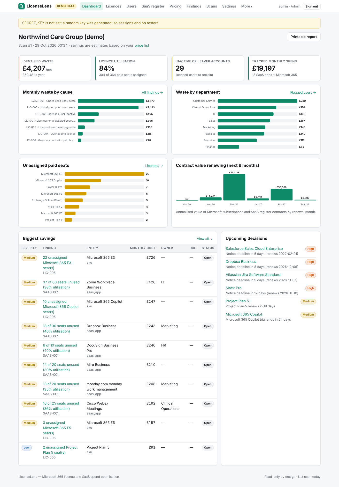

# LicenseLens

**Microsoft 365 licence and SaaS spend optimisation.** LicenseLens reads your Microsoft 365 tenant (read-only),
finds licences you are paying for but not using, and tracks every other SaaS subscription so no renewal or notice
deadline slips past.

[](https://github.com/OWNER/licenselens/actions/workflows/ci.yml)




## What it finds

- **Leavers still licensed** — disabled accounts holding paid licences.
- **Inactive and never-used accounts** — using both interactive *and* non-interactive sign-in dates, so
  Outlook-only users are not falsely flagged.
- **Overlapping licences** — e.g. Exchange Online Plan 1 on top of Microsoft 365 E3, or Power BI Pro alongside E5.
- **Unassigned seats** — bought but never assigned, with the next renewal date so you right-size in time.
- **Guests with paid licences**, **trial expiries** and **subscriptions in warning/suspended state**.
- **SaaS register** for everything outside Microsoft: under-used seats, notice deadlines (renewal date minus
  notice period), overlapping tools in the same category and subscriptions with no owner.

Every saving is **de-duplicated** (a leaver with an overlapping licence is counted once) and calculated from
*your* prices on the Pricing page.

## Detection rules

| Rule | Severity | Category | Detects |
|---|---|---|---|
| `LIC-001` | high | Microsoft 365 | **Licences on a disabled account** — A blocked or disabled account still has paid licences assigned. This is usually a leaver whose licences were never reclaimed. |
| `LIC-002` | medium | Microsoft 365 | **Licensed user inactive** — An enabled user with paid licences has not signed in (interactively or non-interactively) for longer than the inactivity threshold. |
| `LIC-003` | medium | Microsoft 365 | **Licensed user never signed in** — The account was created more than the grace period ago, holds paid licences and has never signed in. |
| `LIC-004` | medium | Microsoft 365 | **Overlapping licence** — The user holds a licence whose features are already included in a larger plan they also hold (for example Exchange Online Plan 1 alongside Microsoft 365 E3). |
| `LIC-005` | low | Microsoft 365 | **Unassigned purchased seats** — Seats have been bought but are not assigned to anyone. Annual commitments can usually only be reduced at renewal, so plan the reduction before the renewal date. |
| `LIC-006` | medium | Microsoft 365 | **Guest account with paid licence** — An external guest holds a paid licence. Guests rarely need one; check the business case. |
| `LIC-007` | low | Renewals | **Subscription renewal approaching** — A Microsoft subscription renews or ends within the renewal window. This is the moment to right-size seat counts. |
| `LIC-008` | high | Renewals | **Subscription in warning or suspended state** — A subscription is in a warning, suspended or locked-out state and users may lose access. |
| `SAAS-001` | medium | SaaS register | **Under-used SaaS seats** — Fewer seats are in use than were purchased, below the utilisation target. |
| `SAAS-002` | high | SaaS register | **Renewal notice deadline approaching** — The last date to give notice (renewal date minus notice period) is close. Missing it usually locks you into another term. |
| `SAAS-003` | low | SaaS register | **Overlapping tools in the same category** — Two or more tools serve the same purpose. Consolidating usually saves money and reduces data sprawl. |
| `SAAS-004` | low | SaaS register | **SaaS subscription without an owner** — No business owner is recorded, so nobody is accountable for usage, renewal or offboarding. |

## Quick start (demo data, two minutes)

```bash
git clone https://github.com/OWNER/licenselens.git && cd licenselens
python -m venv .venv && source .venv/bin/activate     # Windows: .venv\Scripts\activate
pip install -e ".[dev]"
cp .env.example .env
python -m licenselens serve
```

Open <http://127.0.0.1:8000> and sign in with `admin` / `changeme-demo`. Demo mode generates a realistic
245-user tenant and a 13-app SaaS register — nothing leaves your machine.

Or with Docker:

```bash
cp .env.example .env
docker compose up --build
```

## Connect your tenant

1. **Create an app registration** in Entra ID (single tenant, no redirect URI).
2. Add these **Microsoft Graph application permissions** and grant admin consent:

   | Permission | Why |
   |---|---|
   | `User.Read.All` | users, account state and assigned licences |
   | `Organization.Read.All` | purchased SKUs and seat counts |
   | `LicenseAssignment.Read.All` | subscription renewal dates |
   | `AuditLog.Read.All` | last sign-in dates (needs Entra ID P1/P2) |

3. Create a client secret (or certificate) and set in `.env`:

   ```ini
   DEMO_MODE=false
   AZURE_TENANT_ID=...
   AZURE_CLIENT_ID=...
   AZURE_CLIENT_SECRET=...
   SECRET_KEY=<python -c "import secrets; print(secrets.token_urlsafe(48))">
   ADMIN_PASSWORD=<12+ characters>
   ```

4. Validate and scan:

   ```bash
   python -m licenselens check   # tests the Graph credentials
   python -m licenselens scan    # one scan, JSON summary (useful for cron/CI)
   ```

5. Replace the indicative prices on **Pricing** with the prices on your agreement (CSP/EA/MCA).

If a permission is missing the scan still runs and tells you which rules were skipped.

## Working with findings

Each finding has an owner, a status (open → in progress → resolved, or *risk accepted* with a justification and
an expiry of up to 365 days), a comment history and an audit trail. Findings resolve automatically when a scan
no longer detects them and reopen if they come back. Expired risk acceptances reopen on the next scan.

Exports: findings CSV (filtered), SaaS register CSV, a printable report (save as PDF) and a JSON API.

## Configuration

| Variable | Default | Purpose |
|---|---|---|
| `DEMO_MODE` | `true` | `false` reads your tenant |
| `SECRET_KEY` | random per start | signs session cookies — set it in production |
| `ADMIN_USERNAME` / `ADMIN_PASSWORD` | `admin` / demo only | administrator sign-in (12+ chars in live mode) |
| `VIEWER_USERNAME` / `VIEWER_PASSWORD` | `auditor` / unset | optional read-only account |
| `API_TOKEN` | unset | bearer token for `/api/summary` and `/api/findings` |
| `SESSION_COOKIE_SECURE` | `false` | set `true` behind HTTPS |
| `DATABASE_PATH` | `data/licenselens.db` | SQLite file |
| `SCAN_INTERVAL_HOURS` | `0` | automatic scans (0 = manual) |
| `CURRENCY_SYMBOL` | `£` | display currency |
| `AZURE_TENANT_ID`, `AZURE_CLIENT_ID`, `AZURE_CLIENT_SECRET` | — | Graph app registration |

Thresholds (inactivity days, exclusions such as break-glass accounts, utilisation target, renewal windows and
the licence overlap map) are edited in **Settings**.

## API

```bash
curl -H "Authorization: Bearer $API_TOKEN" http://localhost:8000/api/summary
curl -H "Authorization: Bearer $API_TOKEN" "http://localhost:8000/api/findings?rule=LIC-001&status=active"
```

## Architecture

```
licenselens/
├── app.py          # product spec: navigation, settings, rules, entry point
├── collector.py    # Microsoft Graph collection + normalisation (read-only)
├── demo.py         # synthetic tenant in Graph's response shape (same code path as live)
├── rules.py        # pure functions: dataset + settings → findings
├── catalog.py      # SKU names, indicative prices, overlap map
├── views.py        # product pages
├── templates/
└── core/           # shared web shell: auth, findings lifecycle, settings, Graph client, scanner, charts
```

FastAPI + Jinja2, server-rendered (no build step, works without JavaScript), SQLite storage, SVG charts.
Run a single worker: scans run in-process.

## Security

Read-only by design, strict CSP, CSRF protection, throttled sign-in, audit log. See [SECURITY.md](SECURITY.md).

## Development

```bash
pytest -q        # unit + integration tests (Graph calls are mocked)
ruff check .
```

## Roadmap

- Multi-tenant mode for MSPs (one deployment, many customer tenants)
- Entra ID single sign-on for the web app
- Microsoft 365 usage reports (per-app activity) to suggest downgrades, e.g. E3 → F3
- Scheduled email digests to licence owners

## Disclaimer

Prices shipped with the app are indicative and only used to estimate savings. Check licensing terms before
removing licences that hold data (mailboxes, OneDrive) — convert to shared mailboxes or apply retention first.

## Licence

MIT © 2026 Olatunji Kayode Jaiyeola
